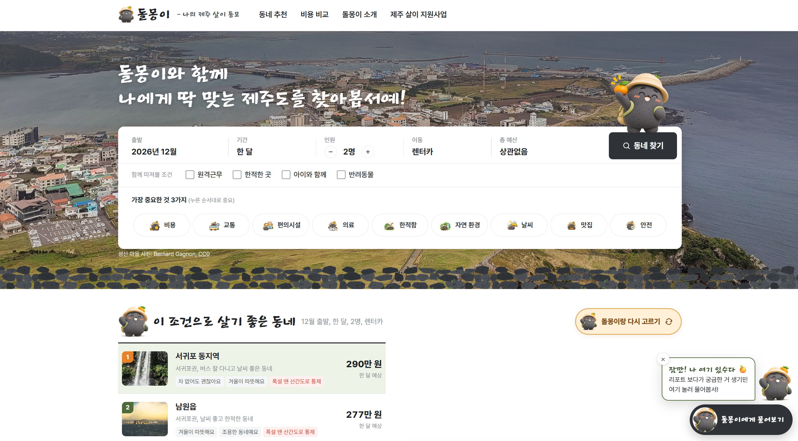
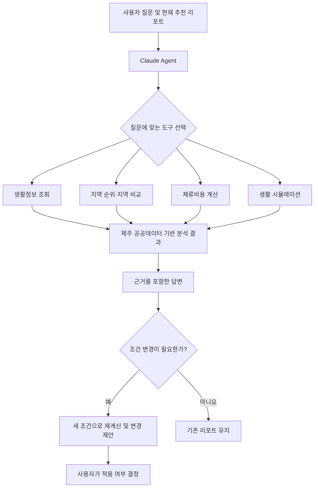

<div align="center">

# 🍊 돌몽이 (Dolmong)

### 제주에서 잠깐 살아볼까? 데이터로 찾는 나만의 제주살이

**제주 AI·빅데이터 활용 AI Agent 개발 챌린지 | 팀 돌몽이키우기**

제주에 2주부터 1년까지 머물고 싶은 사람을 위한 **데이터 기반 제주 생활권 추천·체류비용 분석·AI 상담 서비스**

</div>

---

## 🌿 프로젝트 소개

제주 한 달 살이를 준비할 때는 숙소비뿐 아니라 교통, 식비, 병원 접근성, 계절별 날씨와 생활환경까지 따져야 합니다. 하지만 필요한 정보는 여러 곳에 흩어져 있고, 지역마다 어떤 차이가 있는지 비교하기 어렵습니다.

**돌몽이**는 제주 공공데이터를 생활권 단위로 정리하고, 사용자의 체류 조건에 맞춰 **예상 비용과 생활환경을 함께 비교**합니다. 제주살이 친구 **돌몽이**와 자연어로 상담하면서 추천 이유를 확인하거나 조건을 바꿔 새로운 결과를 받아볼 수도 있습니다.

> **예시**  “1월부터 석 달 동안 둘이서, 차 없이 지내고 싶어. 예산은 900만 원이야.”
>
> → 생활권별 예상 체류비용과 추천 순위 확인 → 교통·의료·날씨 근거 살펴보기 → 돌몽이와 대화하며 조건 재설정

## ✨ 주요 기능

| 기능 | 설명 |
|---|---|
| **맞춤형 제주 생활권 추천** | 기간, 시작 월, 인원, 예산, 렌터카 사용 여부, 자녀·반려동물 동반, 원격근무·한적함 선호 등을 반영해 14개 생활권을 비교합니다. |
| **체류비용 추정** | 숙소·식비·교통/렌터카·공과금 등을 함께 계산하고 지역 간 예상 비용 차이를 보여줍니다. |
| **생활환경 분석** | 버스, 병·의원, 응급실, 자연환경, 관광 혼잡, 기후 등 다양한 지표를 함께 살펴봅니다. |
| **근거를 확인하는 리포트** | 추천 이유, 지표별 점수, 데이터 출처와 계산 근거를 확인할 수 있습니다. |
| **돌몽이 AI Agent 상담** | Claude가 질문의 의도를 파악해 필요한 분석 도구를 호출하고, 지역 비교·비용 계산·생활정보 조회 결과를 설명합니다. |
| **대화형 조건 변경** | 대화에서 새로운 조건이 나오면 다시 계산하고 리포트 수정을 **제안**합니다. 최종 적용은 사용자가 결정합니다. |



## 🤖 AI Agent는 어떻게 동작하나요?

돌몽이는 단순히 생성형 AI가 답변을 작성하는 챗봇이 아니라, **Claude의 도구 호출(tool use)**과 실제 데이터 계산 기능을 연결한 Agent입니다.



**역할 분리**
- **Claude:** 자연어 이해, 도구 선택 및 호출 순서, 결과 설명
- **Python 분석 도구:** 데이터 조회, 지표 계산, 비용 및 추천 순위 산출
- **사용자:** 변경 제안 검토 및 최종 적용 결정

Agent 도구 7종: `ask_data`, `rank_regions`, `compare_regions`, `estimate_cost`, `get_region_detail`, `rehearse`, `propose_report_change`

배포된 웹 서비스에서 Claude API 연동 및 대화형 도구 활용 흐름을 확인했습니다. API 키는 저장소에 포함하지 않고 배포 환경변수로 관리합니다.

## 📊 데이터 활용

제주데이터허브 및 제주빅데이터센터의 지역 데이터를 중심으로 교통·생활편의·의료·안전 관련 시설·자연·날씨·관광·상권 정보를 생활권별로 가공했습니다.

| 분야 | 주요 활용 데이터 | 활용 예시 |
|---|---|---|
| 교통 | 버스 정류소·노선 | 차량 미이용자의 교통 편의 비교 |
| 의료 | 병·의원, 응급실 정보 | 의료시설 접근성과 자녀 동반 조건 반영 |
| 주거·비용 | 국토교통부 전월세 실거래가, 공개 가격 자료 | 지역별 상대 임대지수 및 예상 체류비용 계산 |
| 계절·환경 | 기온·습도·풍속, 항공기 소음 등 | 계절별 생활환경 분석 |
| 지역 생활 | 음식점, 상권, 관광지·축제, 유동인구 등 | 생활편의 및 방문·여가 환경 비교 |

**데이터 처리 흐름:** 원천 데이터 수집 → 정제·지역 매핑 → 14개 생활권별 지표 산출 → 추천 및 비용 계산 → 리포트·Agent 활용

> **해석 시 유의사항:** 표시되는 체류비용은 실제 예약 가능한 숙소의 견적이 아니라 공개 자료와 가정을 결합한 **비교용 추정치**입니다. CCTV·신고 관련 수치 등은 개인의 안전을 직접 보장하는 지표가 아닙니다. 출처·계산 방식과 세부 제약은 `docs/` 문서를 참고하세요.

## 🛠 기술 스택

| 영역 | 기술 |
|---|---|
| Frontend | HTML, CSS, JavaScript |
| Backend / API | Python, FastAPI, Uvicorn |
| AI Agent | Anthropic Claude API, Tool Use |
| 데이터 처리 | Pandas, CSV, SQL |
| 데이터베이스·수집 | Supabase (PostgreSQL, Edge Functions) |
| 배포 | Vercel |
| 테스트 | Pytest |

## 🚀 로컬 실행

**요구사항:** Python 3.10 이상

```bash
git clone https://github.com/jaeho222/dol_mong_e.git
cd dol_mong_e
python -m venv .venv
```

가상환경 활성화:

```bash
# Windows
.venv\Scripts\activate

# macOS / Linux
source .venv/bin/activate
```

의존성 설치 및 실행:

```bash
pip install -r requirements.txt

# Windows
copy .env.example .env
# macOS / Linux: cp .env.example .env

uvicorn backend.main:app --reload
```

브라우저에서 **http://localhost:8000** 으로 접속합니다.

- 로컬에서 Claude 상담을 사용하려면 `.env`의 `ANTHROPIC_API_KEY`에 본인의 키를 설정하세요.
- 키가 없는 로컬 환경에서는 규칙·데이터 기반 상담 모드로 동작할 수 있습니다. **이는 배포된 웹에서의 Claude Agent 연동 상태와는 별개**입니다.
- `.env`, 실제 API 키, DB 접속 정보는 커밋하지 마세요.

테스트:

```bash
python -m pytest -q
```

FastAPI API 문서: `http://localhost:8000/docs`

## 📂 프로젝트 구조

```text
dol-mong-e/
├── backend/
│   ├── agent/           # Claude Agent, 프롬프트 및 상담 처리
│   ├── tools/           # 비용·추천·지역정보 등 분석 함수
│   ├── main.py          # FastAPI 엔드포인트
│   └── schema.py        # 사용자 조건 스키마
├── frontend/            # 서비스 화면 및 정적 리소스
├── data/
│   ├── processed/       # 서비스에서 사용하는 가공 데이터
│   └── build/           # 수집·전처리·내보내기 파이프라인
├── supabase/            # 데이터 적재 및 SQL/Edge Functions
├── docs/                # 데이터·비용 모델 상세 문서
├── tests/               # 자동 테스트
├── requirements.txt
├── .env.example
└── README.md
```

## 🧪 구현 및 검증

- 사용 조건에 따른 생활권 추천 및 체류비용 계산
- Claude Agent의 데이터 조회·비교·조건 변경 제안 흐름을 배포 웹에서 확인
- `pytest` 자동 테스트 **22개 통과** (제출 결과 기준)
- 추천 지표와 비용 추정의 계산 기준 및 제한사항 문서화

자동 테스트 결과는 계산·도구 연동 코드에 대한 검증이며, 실제 숙소 시세에 대한 예측 정확도나 전체 사용자 만족도를 의미하지는 않습니다.

## 📚 추가 자료

- [데이터 활용 및 출처](docs/DATA.md)
- [데이터 목록](docs/DATA_CATALOG.md)
- [비용 추정 모델](docs/COST_MODEL.md)

## 👥 팀

**고등어회** — 제주 AI·빅데이터 활용 AI Agent 개발 챌린지 출품작

---

<div align="center">

**제주에서 살아볼 동네를 고르는 일, 돌몽이와 함께.**

</div>
