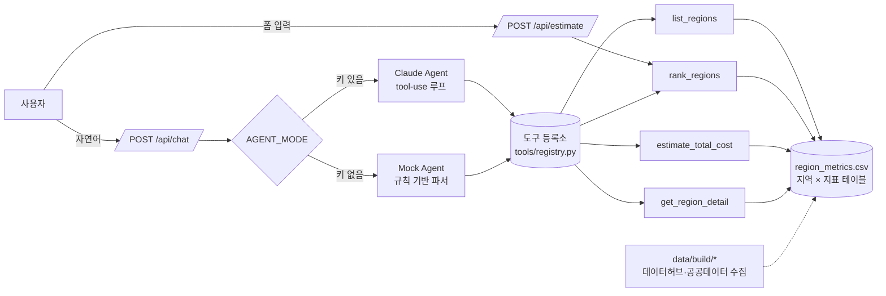

# ᄆᆞ슬 [모슬] — 제주 한달살이 동네별 비용 비교 Agent (`bang-aeo-hwae`)

> **ᄆᆞ슬**은 제주어로 '마을'(중세국어 ᄆᆞᅀᆞᆶ → 제주어 ᄆᆞ슬 → 표준어 마을). 한 달 머물 ᄆᆞ슬을 고르는 서비스라는 뜻. 슬로건: "숨 고를 한 달".

> **"1월부터 3개월, 둘이서, 차 없이, 월 300 이내"** 라고 말하면
> 제주 동네별 **체류 총비용**(숙소·렌터카·식비·난방비)과 **생활환경**(교통·병원·날씨·한적함)을 계산해
> 나에게 맞는 동네를 추천하는 AI Agent.

제주 AI·빅데이터 활용 AI Agent 개발 챌린지 출품작 (팀 고등어회). 제출 마감 **2026-11-20(금) 10:00**.

> ⚠️ 현재 상태: **프로토타입 뼈대**. 처음부터 끝까지 돌아가지만 데이터는 **더미**, 단가는 **가정값**이다.
> 각자 맡은 `TODO[...]` 를 채우면 완성되는 구조. → [할 일](#-할-일-역할별-todo)


---

## 목차
1. [빠른 시작](#-빠른-시작)
2. [어떻게 동작하나](#-어떻게-동작하나)
3. [폴더 구조](#-폴더-구조)
4. [확장 가이드 — 기능 추가하는 법](#-확장-가이드--기능-추가하는-법)
5. [할 일 (역할별 TODO)](#-할-일-역할별-todo)
6. [디자인 시스템](#-디자인-시스템)
7. [데이터 출처·이용조건](#-데이터-출처이용조건)
8. [협업 규칙](#-협업-규칙)
9. [제출 체크리스트](#-제출-체크리스트)

---

## 🚀 빠른 시작

요구사항: **Python 3.10+** (센터 PC: i7-8700 / GTX1060 / RAM 32GB — 로컬 LLM 없이 외부 API만 사용하므로 충분)

```bash
git clone https://github.com/jaeho222/bang-aeo-hwae.git
cd bang-aeo-hwae
python -m venv .venv
# macOS/Linux
source .venv/bin/activate
# Windows (센터 PC)
.venv\Scripts\activate

pip install -r requirements.txt
cp .env.example .env          # Windows: copy .env.example .env
uvicorn backend.main:app --reload
```

브라우저에서 **http://localhost:8000** 접속.

- `.env` 의 `ANTHROPIC_API_KEY` 가 **비어 있으면 데모(mock) 모드**로 자동 실행된다. 규칙 기반 파서가 조건을 뽑고 같은 도구를 호출하므로, 키 없이도 화면·도구 개발을 할 수 있다.
- 키를 넣으면 **Claude 모드**: Claude가 조건 추출 → 도구 선택·호출 → 답변 생성까지 스스로 한다.

테스트:
```bash
python -m pytest -q
```

### ☁️ Vercel 배포 (팀원·심사위원에게 링크 공유용)
설정 파일은 이미 들어 있다 — 루트 `index.py` 가 FastAPI `app` 을 내보내면 Vercel이 자동 인식한다.
1. [vercel.com/new](https://vercel.com/new) → GitHub `jaeho222/bang-aeo-hwae` **Import** (빌드 설정은 건드리지 않음)
2. *Environment Variables* 에 `ANTHROPIC_API_KEY`(있을 때만), `CLAUDE_MODEL` 추가 → **Deploy**
3. 이후 `main` 에 push 할 때마다 자동 재배포, PR마다 미리보기 URL 생성

> 키를 넣지 않으면 배포본도 데모(mock) 모드로 돈다. 공개 링크에 키를 넣을 땐 Anthropic 콘솔에서 **사용 한도**를 먼저 걸 것.

### 📌 서버 없는 단일 HTML 데모 (노션 임베드·발표 백업용)
```bash
python scripts/build_static_demo.py   # → dist/demo.html
```
예시 질문의 결과를 미리 계산해 HTML 하나에 담는다. 노션 「구현 현황」 페이지의 미리보기가 이것.

---

## 🧭 어떻게 동작하나



**핵심 설계 3가지**

1. **데이터는 테이블 하나** — 모든 원천 데이터는 `data/build` 에서 미리 집계해 `region_metrics.csv`(지역 × 지표) 하나로 만든다. Agent는 실시간으로 외부 API를 부르지 않는다 → 센터 PC에서도 빠르고, 결과 재현 가능.
2. **도구는 순수 함수** — 계산은 전부 파이썬 함수(`backend/tools/`)가 하고, LLM은 "조건 해석·도구 선택·설명"만 한다. 숫자를 LLM이 지어내지 않는다 (프롬프트 규칙 2).
3. **조건은 하나의 구조로** — 폼이든 자연어든 `Conditions`(`backend/schema.py`)로 정리된다. 기간(2주~1년)·시작일·인원·차·예산·아이·원격근무·한적함을 지원하며, 기간에 따라 단기숙소/연세를 자동 비교한다.

| API | 설명 |
|---|---|
| `GET /api/health` | 현재 모드(claude/mock), 더미 데이터 여부 |
| `GET /api/regions` | 지역 목록 |
| `POST /api/estimate` | `{"conditions": {...}, "top_k": 6}` → 순위·비용 (LLM 안 씀) |
| `POST /api/chat` | `{"message": "..."}` → `{answer, ranked, trace, mode}` |

`/docs` 에 FastAPI 자동 문서(Swagger)가 있다.

---

## 📁 폴더 구조

```
bang-aeo-hwae/
├─ backend/
│  ├─ main.py              # FastAPI 서버 + 프론트 정적 서빙
│  ├─ config.py            # 환경변수 (모델, 모드, 데이터 경로)
│  ├─ schema.py            # Conditions — 사용자 조건 정의
│  ├─ agent/
│  │  ├─ __init__.py       # run_agent(): claude/mock 자동 선택
│  │  ├─ claude_agent.py   # Claude tool-use 루프
│  │  ├─ mock_agent.py     # 키 없는 데모용 Agent
│  │  ├─ mock_parser.py    # 규칙 기반 자연어 → Conditions
│  │  └─ prompts.py        # 시스템 프롬프트
│  └─ tools/
│     ├─ registry.py       # ★ 도구 등록소 (도구 추가는 여기)
│     ├─ cost.py           # 총비용 추정 (단가 COST 딕셔너리)
│     ├─ region.py         # 지역 점수·순위·배지
│     └─ data_loader.py    # region_metrics.csv 로더
├─ frontend/               # 빌드 없는 HTML/CSS/JS
│  ├─ index.html
│  └─ assets/ (style.css · app.js · config.js)
├─ data/
│  ├─ sample/region_metrics.csv   # 더미 데이터 (지금 앱이 쓰는 것)
│  ├─ build/               # 실제 데이터 수집 스크립트 (TODO)
│  └─ processed/           # build 결과 (실제 데이터)
├─ docs/  (DATA.md · COST_MODEL.md · screenshot.png)
├─ scripts/build_static_demo.py   # 서버 없는 데모 HTML 생성
├─ index.py                # Vercel 진입점
├─ tests/test_tools.py
├─ requirements.txt
└─ .env.example
```

---

## 🧩 확장 가이드 — 기능 추가하는 법

### A. 새 Agent 도구 추가 (예: "기간별 비용 비교")
1. `backend/tools/` 에 함수 작성 — dict 입력 → JSON 직렬화 가능한 dict 반환
   ```python
   # backend/tools/compare.py
   from backend.tools.cost import estimate_total_cost
   def compare_stay_length(region_id: str, conditions: dict) -> dict:
       return {d: estimate_total_cost(region_id, {**conditions, "days": d})["total"] for d in (30, 90, 180, 365)}
   ```
2. `backend/tools/registry.py` 의 `TOOLS` 에 등록
   ```python
   Tool(
       name="compare_stay_length",
       description="한 지역에서 1·3·6·12개월 체류 총비용을 비교한다. '얼마나 있어야 이득이야?' 같은 질문에 사용.",
       input_schema={"type": "object", "properties": {"region_id": {"type": "string"}, "conditions": CONDITIONS_SCHEMA},
                     "required": ["region_id", "conditions"]},
       fn=lambda region_id, conditions: compare_stay_length(region_id, conditions),
   ),
   ```
3. `tests/test_tools.py` 에 테스트 한 줄. 끝 — Claude 모드에서는 자동으로 쓰기 시작한다.
   > `description` 이 Claude가 도구를 고르는 유일한 근거다. **"언제 쓰는지"** 를 구체적으로.

### B. 새 사용자 조건 추가 (예: 반려동물 동반)
`backend/schema.py` 상단 주석의 4단계: `Conditions` 필드 → `mock_parser.py` 규칙 → `registry.py` 의 `CONDITIONS_SCHEMA` → `region.py` 의 `_weights`/`_badges`. 폼에서도 받으려면 `index.html` 칩 + `app.js` 의 `readForm()`.

### C. 새 생활환경 지표 추가 (예: 공원 수)
`docs/DATA.md` 의 "컬럼 추가 체크리스트" 참고. `region.py` 의 `LIVING_METRICS` 에 한 줄 추가하면 점수에 반영된다.

### D. 더미 → 실제 데이터 교체
`data/build/README.md` 의 표대로 스크립트를 채우고 `python -m data.build.merge` → `.env` 에 `REGION_METRICS_PATH=data/processed/region_metrics.csv`. 화면의 "더미 데이터" 경고는 `is_dummy` 가 0이 되면 자동으로 사라진다.

### E. 비용 단가 보정
`backend/tools/cost.py` 의 `COST` 딕셔너리만 고치고, 근거를 `docs/COST_MODEL.md` 표에 적는다.

### F. 서비스 이름·문구·색 바꾸기
- 이름/문구/예시 질문: `frontend/assets/config.js`
- 색·반경: `frontend/assets/style.css` 맨 위 `:root` 토큰
- Agent 말투: `backend/agent/prompts.py`

---

## ✅ 할 일 (역할별 TODO)

코드 안에 `TODO[DATA]`, `TODO[AGENT]`, `TODO[FRONT]` 로 표시돼 있다. `grep -rn "TODO\[" .` 로 전체 확인.

| 역할 | 할 일 | 우선순위 |
|---|---|---|
| **DATA** | 데이터허브 **748·746·956** 다운로드 → `jejuhub_*.py` (**대회 필수 데이터**) | 🔴 오늘 |
| DATA | data.go.kr 활용신청 일괄 (전월세 3종·버스·상가·HIRA·ASOS·민박) | 🔴 오늘 |
| DATA | 나머지 build 스크립트 → `merge.py` → processed CSV | 🟠 |
| DATA | 매물 20~30건 수동 수집으로 `COST` 보정 | 🟠 |
| **AGENT** | Claude 키 발급 후 `AGENT_MODE=claude` 로 프롬프트·도구 설명 튜닝 | 🔴 키 받으면 |
| AGENT | 멀티턴 대화(history), 기간 비교 도구, 지원금 안내 도구 | 🟡 |
| AGENT | mock 파서 테스트 문장 보강 (`tests/`) | 🟡 |
| **FRONT** | 지도에 결과 표시, 카드 상세 모달, 기간별 비교 차트 | 🟠 |
| FRONT | 서비스 이름 확정 후 `config.js` 반영, 로고 | 🟡 |
| **문서** | 기획서(15p) · 결과 설명자료 · 사용자 매뉴얼 | 🔴 |

---

## 🎨 디자인 시스템

**로고:** `ᄆᆞ슬` — 제주한라산체 붓글씨. 'ᄆᆞ'는 현무암색, '슬'은 이끼색, 아래아(ㆍ)는 이끼색 점, 현무암 글자 위에 이끼 장식. 이 폰트는 옛한글 조합을 지원하지 않아서 '므'의 윗부분(ㅁ)과 같은 폰트의 'ㆍ'를 위아래로 붙여 'ᄆᆞ'를 만들고 패스로 변환했다(폰트 없이 동일하게 보임). 다시 만들기: `python scripts/build_logo.py <jeju-hallasan ttf>`. 부제 [모슬]은 처음 보는 사람을 위한 읽는 법. 다시 만들 땐 `python scripts/build_logo.py <jua 폰트 폴더>` (방법은 스크립트 상단).

**배너 일러스트:** 귤·돌하르방·한라산·돌담과 초가를 단순한 도형으로 직접 그린 SVG (`app.js` 의 `ART`). 배너 문구는 작은 글씨=기능, 큰 글씨=핵심 한 줄, '~해요' 말투는 쓰지 않는다.

**레이아웃 참고: [노트폴리오](https://notefolio.net)** — 상단 띠 배너 → 헤더 → 가로 배너 캐러셀 → 권역 탭 → 이미지 카드 그리드 → 하단 내비.
레퍼런스는 구조만 따왔고 색·문구·도형은 직접 만들었다. "AI가 만든 티"를 줄이려고 이모지를 쓰지 않고, 문구는 사람 말투로 쓴다.

| 역할 | 색 | 쓰는 곳 |
|---|---|---|
| 배경 | 돌담 아이보리 `#fbfaf7` (다크: 현무암 `#151718`) | 바탕 |
| 주색 | **이끼** `#5e7d4a` | 활성 탭, 좋은 점 태그, 버튼 |
| 강조 | **감귤** `#e8792b` | 순위 리본, 주의 태그 — 아껴 쓴다 |
| 권역 타일 | 제주시 현무암 · 서부 이끼 · 동부 바다 `#3f7d7b` · 서귀포 귤껍질 `#b8682e` · 남서부 모래 `#8f7a55` | 동네 카드 썸네일 |

- **배너·문구 수정:** `frontend/assets/config.js` — `topBanner`(맨 위 띠: 제주愛인 메인 링크), `banners`(캐러셀 카드, 클릭 시 링크/질문/조건 프리셋)
- **아이콘:** [Lucide](https://lucide.dev) (ISC 라이선스) 경로를 `index.html` 상단 SVG 스프라이트로 인라인 — 외부 요청 없음
- **폰트:** 본문 Pretendard(CDN) · 로고·배너 제목·동네 이름은 **제주한라산체**(제주특별자치도 제주전용서체 — 웹·임베딩 포함 자유 이용, 유료 양도·판매 금지). `frontend/assets/fonts/jeju-hallasan-sub.woff2` 는 KS X 1001 한글 2,350자로 줄인 파일(191KB) — 여기 없는 글자는 Pretendard로 표시된다.
- **모바일:** 560px 이하에서 동네 카드는 '사진 왼쪽 + 정보 오른쪽' 가로형, 조건 칩은 한 줄 가로 스크롤, 입력창 16px(iOS 확대 방지), 하단 내비는 홈 인디케이터 영역(safe-area) 확보
- **동네 사진:** `frontend/assets/region_images.js` — 위키미디어 공용의 자유 이용 사진(CC0 / CC BY / CC BY-SA / 공공누리 1유형)을 원본 서버에서 바로 불러온다. 카드마다 장소·작가·라이선스를 표시하고 원본 페이지로 링크한다. 사진 교체·추가 방법은 파일 상단 주석. 비영리(NC) 조건 사진은 쓰지 않는다.
- **TODO[FRONT]:** 지도 탭

## 📚 데이터 출처·이용조건

| 구분 | 데이터 | ID | 용도 |
|---|---|---|---|
| **필수** 제주데이터허브 | 유동인구에 따른 카드 매출액 매시업 | 748 | 읍면동 소비 수준, 혼잡도 |
| 〃 | 업종별 카드 매출과 매장수 | 746 | 편의시설 밀도 |
| 〃 | 제주 농어촌 민박 현황 | 956 | 숙소 공급량 |
| 〃 (선택) | 읍면동 내국인 유동인구 (API) | 583 | 최신 거주/방문 인구 |
| 공공데이터포털 | 국토부 전월세 실거래가 (아파트/단독다가구/오피스텔) | 15126474 / 15126472 / 15126475 | 임대 상대지수 |
| 〃 | 제주 버스 정류소·노선 | 15074255 / 15074254 | 교통 점수 |
| 〃 | 소상공인 상가(상권)정보 | 15083033 | 생활편의 |
| 〃 | HIRA 병원정보·약국정보 | 15001698 / 15001673 | 의료 |
| 〃 | 기상청 ASOS 일자료 | 15059093 | 겨울 날씨 |
| 〃 | 농어촌민박업 조회서비스 | 15155113 | 최신 민박 현황 |
| 수동 | 권역 가격대·렌터카 시세·악취관리지역 등 | – | 비용 기준값, 경고 배지 (출처 화면 표기) |

- 데이터허브 상세: `https://jejudatahub.net/data/view/data/{ID}`
- **API 키는 코드·제출물에 넣지 않는다.** 발급 방법만 매뉴얼에 적는다 (대회 규정).
- 대회 제공 엑셀 2종은 **외부 배포·GitHub 업로드 금지** → `.gitignore` 에 `*.xlsx` 처리됨.
- HIRA·기상청 데이터는 출처표시(공공누리 1유형) 필요.
- 동네 사진 출처는 `frontend/assets/region_images.js` 에 사진별로 기록돼 있고 화면에도 표시된다 (위키미디어 공용, CC0·CC BY·CC BY-SA·공공누리 1유형).

---

## 🤝 협업 규칙
- `main` 은 항상 실행되는 상태 유지. 작업은 `feat/<이름>-<내용>` 브랜치 → PR.
- 커밋 메시지: `feat:`, `fix:`, `data:`, `docs:`, `style:` 접두어.
- PR 전 `python -m pytest -q` 통과 확인.
- 데이터 원본(`data/raw`)·`.env`·xlsx 는 절대 커밋하지 않는다.

## 📦 제출 체크리스트
- [ ] 기획서 PDF (15p 이내) — 구현목표 / 서비스 제안 / Agent 구성 / 데이터 활용 계획 / 개발·탑재 계획
- [ ] ZIP: 소스코드 + 프롬프트 + 사용 모델·라이브러리 정보
- [ ] README(설치·실행) + 의존성 + `.env.example` + 사용자 매뉴얼 + 오류·제약사항
- [ ] 데이터 활용 명세 (필수 데이터 사용 내역, 출처·이용조건, 전처리 흐름, 외부 데이터·오픈소스 목록)
- [ ] 결과 설명자료 (문제 정의, Agent 구조, 실행 결과, 검증 방법·한계, 센터 활용 방안)
- [ ] 사용 AI 모델·AI 활용 범위·외부 API 명시
- [ ] 평가용 Claude 키: 사용 한도 설정 후 매뉴얼에 포함 → 평가 종료 후 폐기
